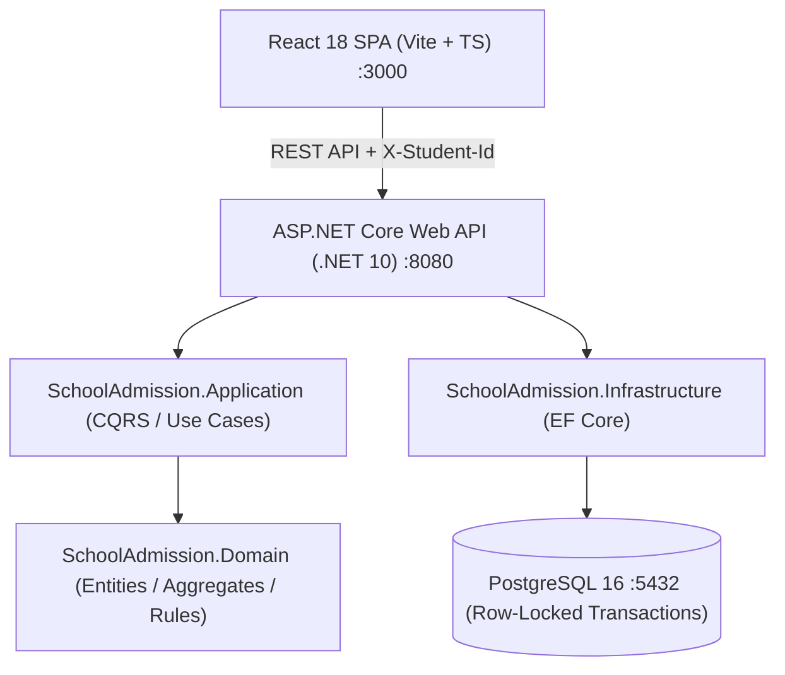

# School Admission System

A production-grade, Docker-first system for a first-come-first-served school admission workflow built with **.NET 10 (`net10.0`)**, **React 18 + TypeScript**, **PostgreSQL 16**, and **Tailwind CSS**.

---

## Architecture Overview



- **Domain Layer (`SchoolAdmission.Domain`)**: Pure C# domain models (`AdmissionClass`, `SeatHold`, `StudentId`) with zero third-party dependencies.
- **Application Layer (`SchoolAdmission.Application`)**: Handlers, contracts, and use cases for seat hold lifecycle and admission classes.
- **Infrastructure Layer (`SchoolAdmission.Infrastructure`)**: EF Core 10, Npgsql provider, migrations, and pessimistic row-level locking (`SELECT ... FOR UPDATE`) preventing race conditions and overselling.
- **API Layer (`SchoolAdmission.API`)**: Controllers, RFC 7807 `ProblemDetails` exception handling, health checks (`/health`), OpenAPI/Scalar docs (`/scalar/v1`), and Swagger UI (`/swagger`).
- **Frontend SPA (`frontend/`)**: High-craft editorial UI built with Vite, React 18, TypeScript, Tailwind CSS, TanStack Query, and Lucide Icons.

---

## Quick Start (Docker)

No local .NET, Node.js, or PostgreSQL installation is needed.

### 1. Configure Environment
```bash
cp .env.example .env
```

### 2. Start Services
```bash
docker compose up --build
```

### 3. Access Endpoints
- **Frontend SPA**: [http://localhost:3000](http://localhost:3000)
- **Parent Applications**: [http://localhost:3000/my-applications](http://localhost:3000/my-applications)
- **School Admin Console**: [http://localhost:3000/admin](http://localhost:3000/admin)
- **Backend API**: [http://localhost:8080](http://localhost:8080)
- **Health Check**: [http://localhost:8080/health](http://localhost:8080/health)
- **Interactive Swagger UI**: [http://localhost:8080/swagger](http://localhost:8080/swagger)
- **Scalar API Reference**: [http://localhost:8080/scalar/v1](http://localhost:8080/scalar/v1)

---

## Local Development (Without Docker)

### Prerequisites
- [.NET 10 SDK](https://dotnet.microsoft.com/)
- [Node.js (v20+) & npm](https://nodejs.org/)
- Running PostgreSQL instance (or run PostgreSQL via Docker: `docker compose up postgres -d`)

### 1. Run Backend API
```bash
dotnet run --project backend/src/SchoolAdmission.API/SchoolAdmission.API.csproj --urls http://localhost:8080
```

### 2. Run Frontend
```bash
npm install --prefix frontend
npm run dev --prefix frontend
```
The frontend starts on [http://localhost:3000](http://localhost:3000).

---

## Verification & Automated Test Suite

The solution includes a comprehensive test suite across backend and frontend (90 automated tests in total, 100% pass rate).

### 1. Run Backend Tests (xUnit)
```bash
dotnet test backend/SchoolAdmission.sln
```
> **60 tests passing**: Domain aggregate invariant validation, use case handlers, RFC 7807 error responses, hold expiration transitions, and concurrent race tests verifying **0 overselling** under 50 simultaneous competing requests.

### 2. Run Frontend Tests (Vitest)
```bash
npm test --prefix frontend
```
> **30 tests passing**: API client header injection, `X-Student-Id` persistence, countdown timers, hold state transitions, class creation validation, and metrics calculation.

### 3. Run Production Frontend Build
```bash
npm run build --prefix frontend
```

---

## API Endpoints Reference

| Method | Endpoint | Required Headers | Description |
|---|---|---|---|
| `GET` | `/classes` | — | Lists all admission classes with dynamic seat counts |
| `GET` | `/classes/{classId}` | — | Returns single admission class details |
| `POST` | `/classes` | — | Creates a new admission unit (`name`, `totalSeats`) |
| `POST` | `/classes/{classId}/holds` | `X-Student-Id` | Requests a seat hold (returns 409 if full or already holding another class) |
| `GET` | `/holds/{holdId}` | — | Returns hold status, expiry timestamp, and class metadata |
| `POST` | `/holds/{holdId}/confirm` | `X-Student-Id` | Confirms payment for hold (idempotent, returns 200) |
| `DELETE` | `/holds/{holdId}` | `X-Student-Id` | Cancels an unconfirmed hold (returns 204) |
| `GET` | `/me/holds` | `X-Student-Id` | Lists all holds belonging to the authenticated student |
| `GET` | `/health` | — | Database health probe (200 OK / 503 Service Unavailable) |
| `GET` | `/swagger` | — | Swagger UI interactive documentation |
| `GET` | `/scalar/v1` | — | Scalar visual API reference |

---

## Core Business Invariants Enforced

1. **Strict First-Come-First-Served**: Seats are reserved with pessimistic database locks (`SELECT ... FOR UPDATE`). Total active holds + confirmed admissions will never exceed `total_seats`.
2. **Hold Expiry**: Holds expire strictly after `HOLD_DURATION_SECONDS` (default: 600s / 10 minutes). Once expired, held seats immediately become available for other applicants.
3. **Single Active Hold per Student**: A student can only hold one seat across all classes at a time.
4. **Idempotent Confirmation**: Repeated payment clicks return `200 OK` with status `CONFIRMED` without duplicate capacity increments.
5. **Data Persistence**: Backed by a named Docker volume (`postgres_data`) preserving all records across container restarts.

---

## Project Documentation

Detailed design decisions and architectural documents are located in [`docs/`](file:///f:/OnnorokomProjukti/school-admission-system/docs/):
- [`docs/01-specification.md`](file:///f:/OnnorokomProjukti/school-admission-system/docs/01-specification.md) — Product specification & requirements.
- [`docs/02-assumptions.md`](file:///f:/OnnorokomProjukti/school-admission-system/docs/02-assumptions.md) — Explicit design assumptions.
- [`docs/20-implementation-plan.md`](file:///f:/OnnorokomProjukti/school-admission-system/docs/20-implementation-plan.md) — Complete phase-by-phase implementation log.
- [`docs/21-acceptance-criteria.md`](file:///f:/OnnorokomProjukti/school-admission-system/docs/21-acceptance-criteria.md) — Verified acceptance criteria checklist.
- [`AI_USAGE.md`](file:///f:/OnnorokomProjukti/school-admission-system/AI_USAGE.md) — AI workflow, verification commands, and tool log.
